# Holy Day Game Show

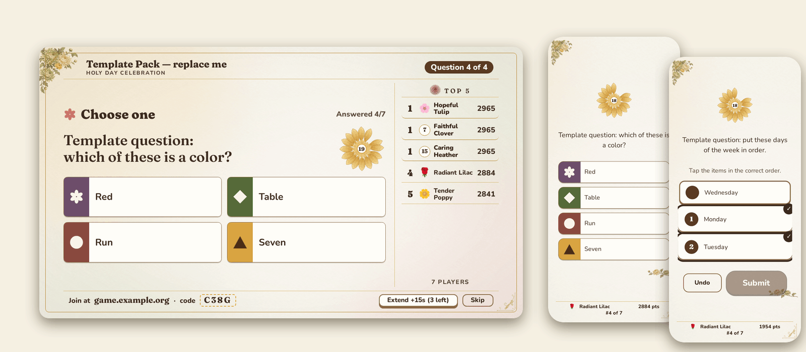

A Jackbox-style party game for Bahá'í Holy Day gatherings. One screen (a TV or projector) shows the game; everyone else joins on their phone with a short room code or by scanning a QR code. Nothing to install, no accounts, no typing names. It is free, open source, and made to be forked and hosted by any community.

## Screenshots

These are made with the demo (template) questions.

| | |
|---|---|
| 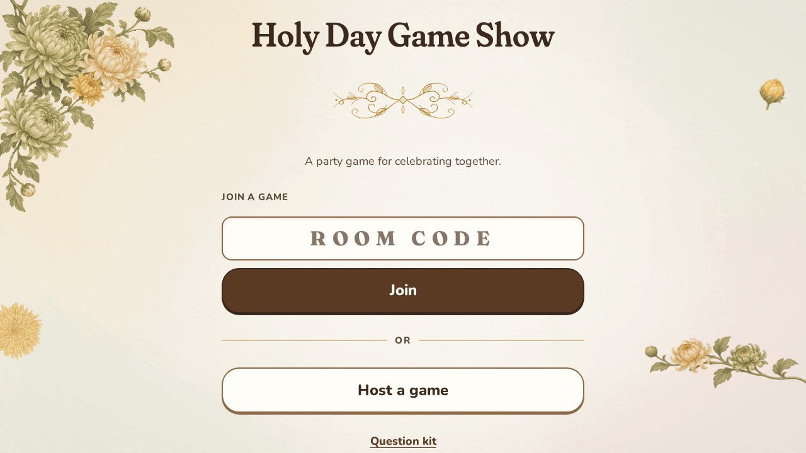<br>The welcome page | 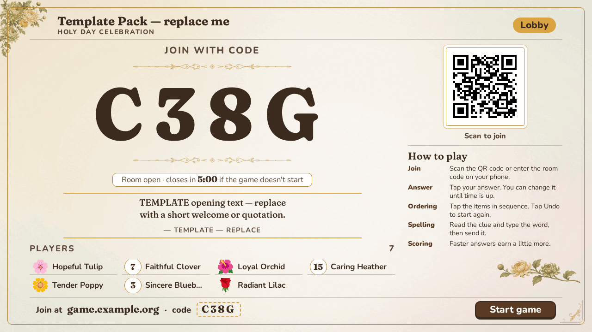<br>Lobby: room code, QR code and players |
| 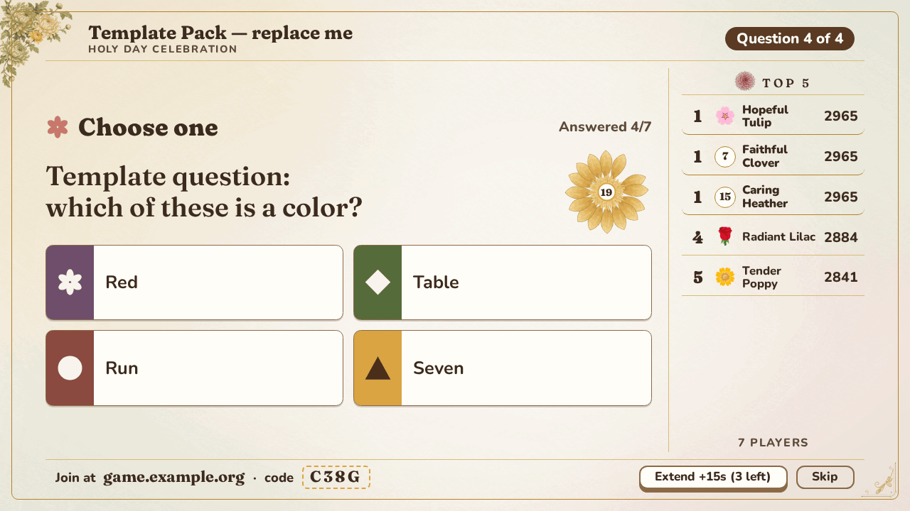<br>A question with the live top-5 | 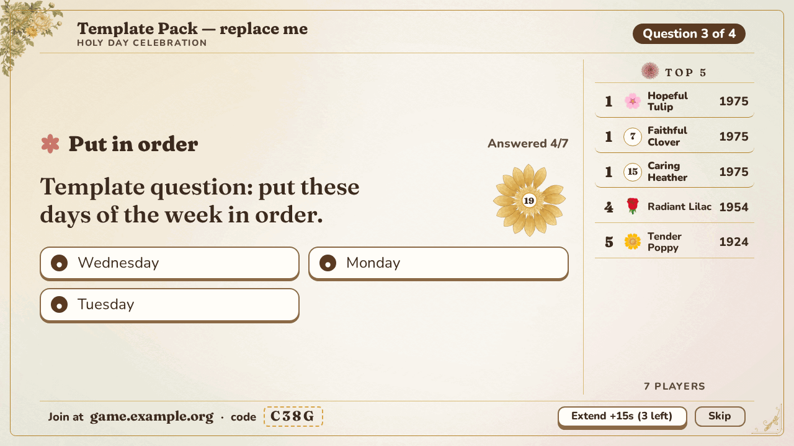<br>The sequence ("put in order") puzzle |
| 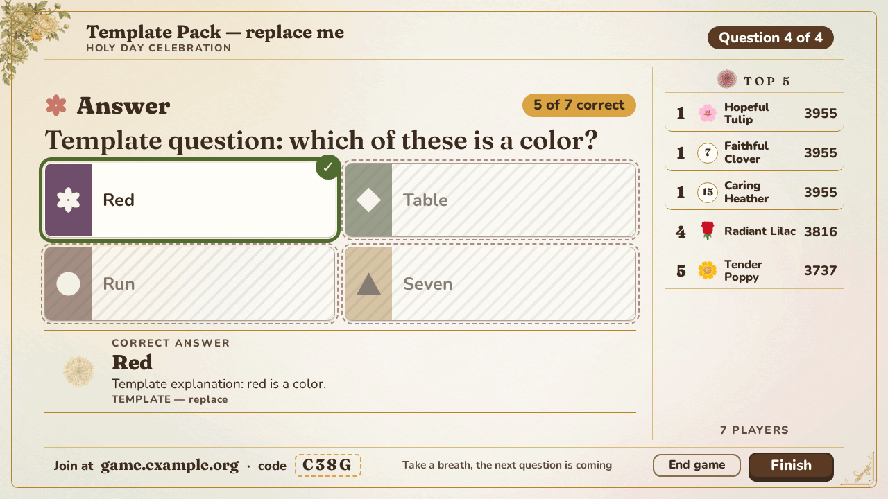<br>Reveal with explanation and source | 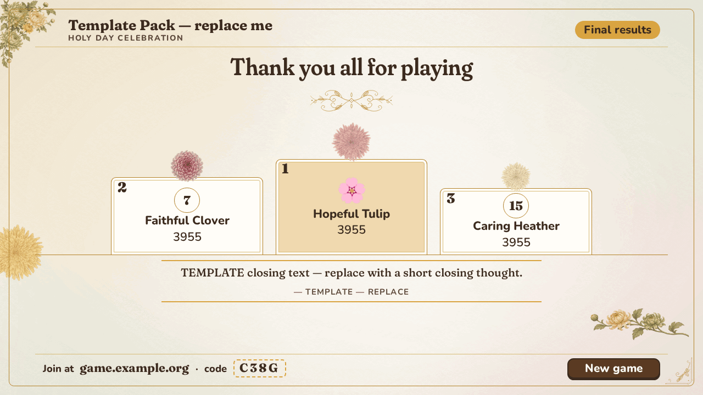<br>The podium |
| 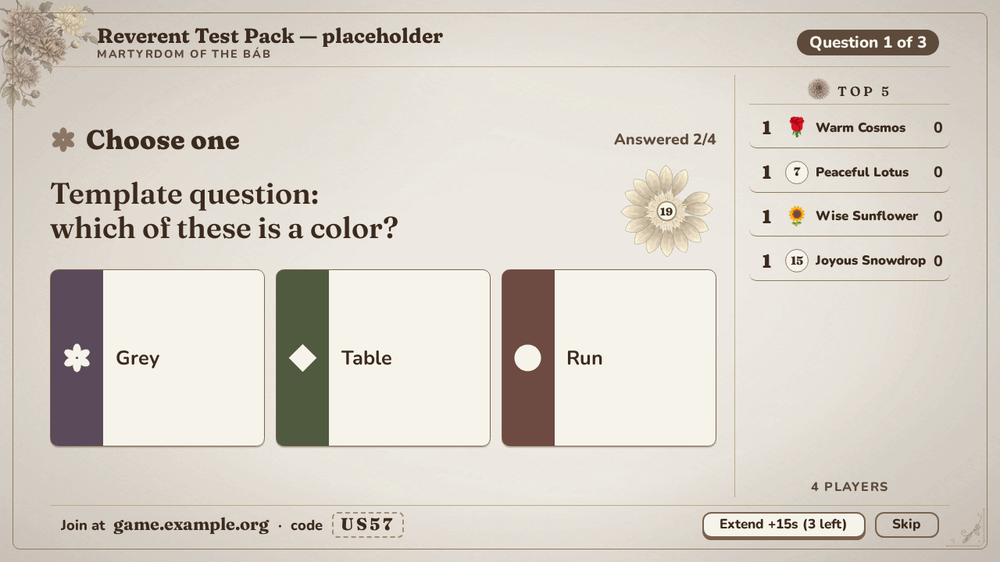<br>Reverent packs are muted, with no confetti | 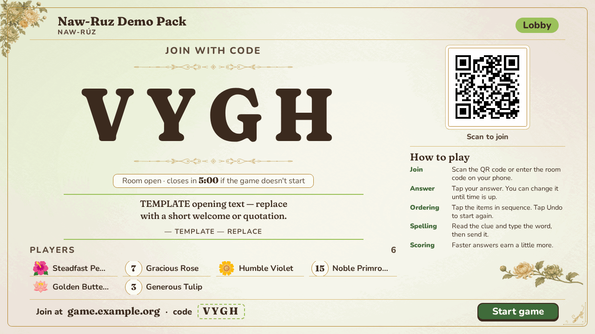<br>Each pack can have its own theme |

On phones:

| Join | Question | Ordering | Locked in | Result | Final |
|---|---|---|---|---|---|
| 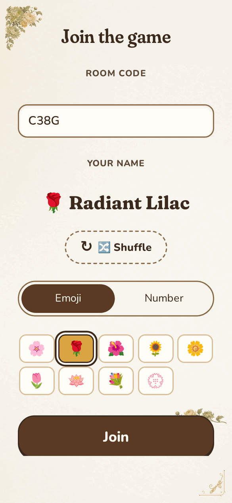 | 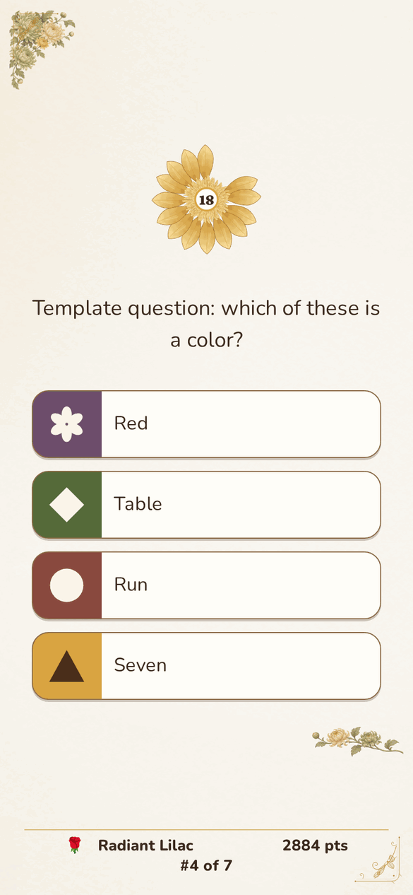 | 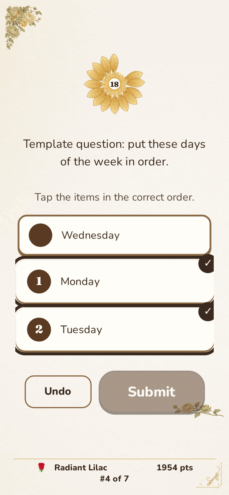 | 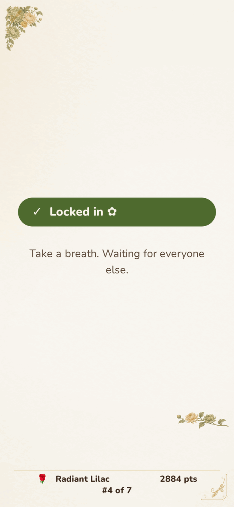 | 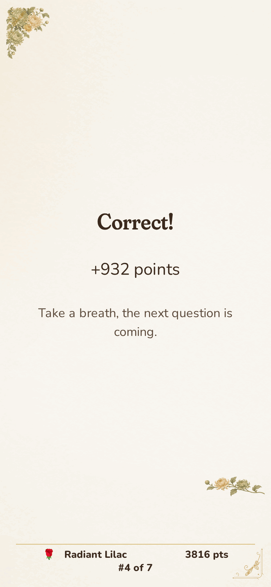 | 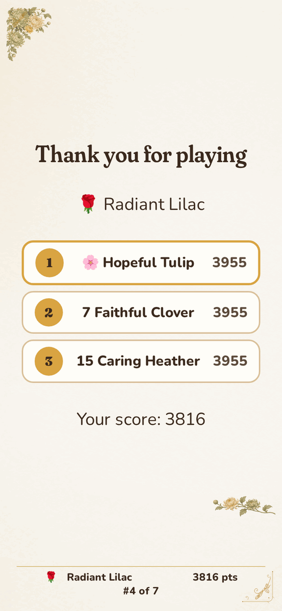 |

The question kit (`/kit`) helps you write questions:

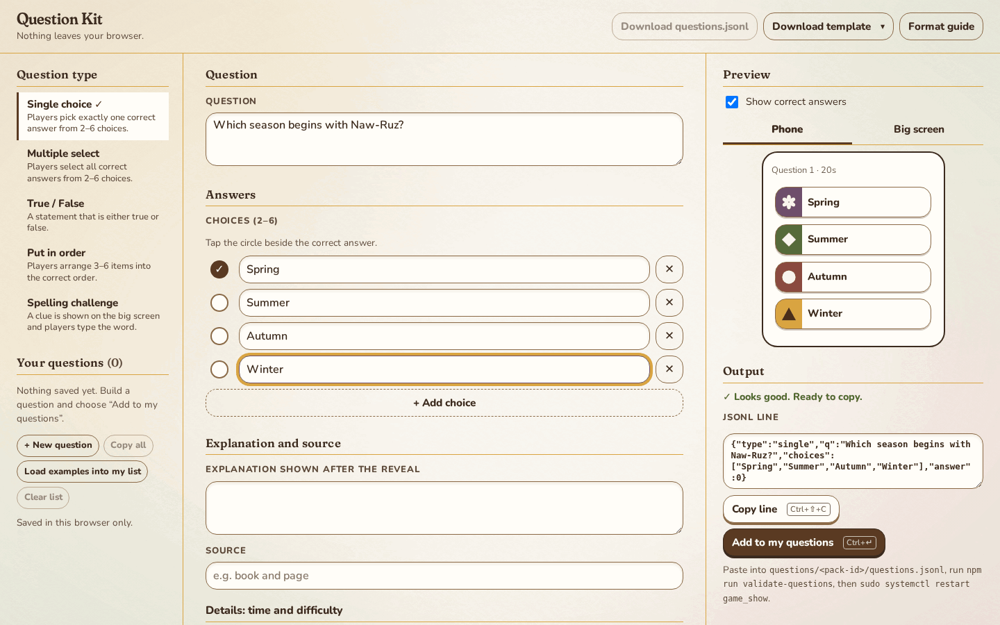

| Format guide | On a phone |
|---|---|
| 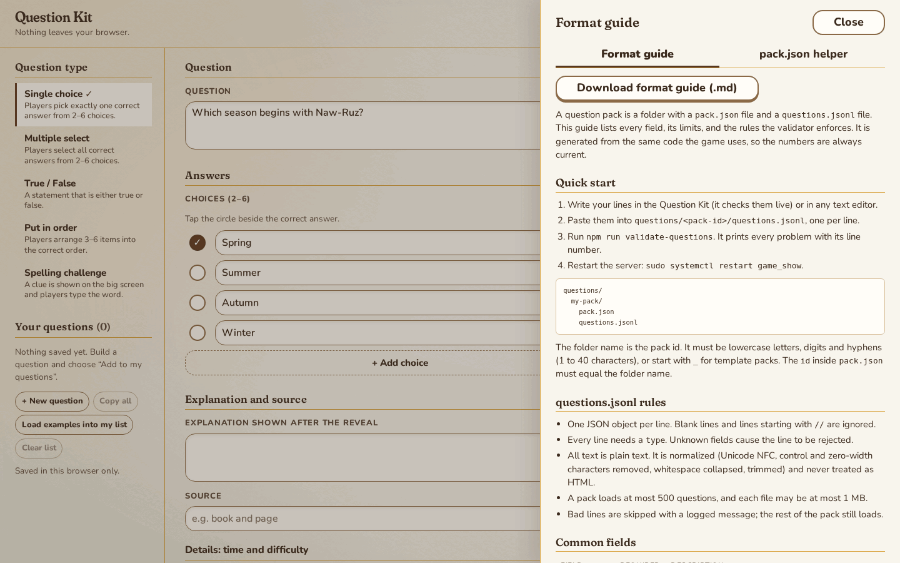 | 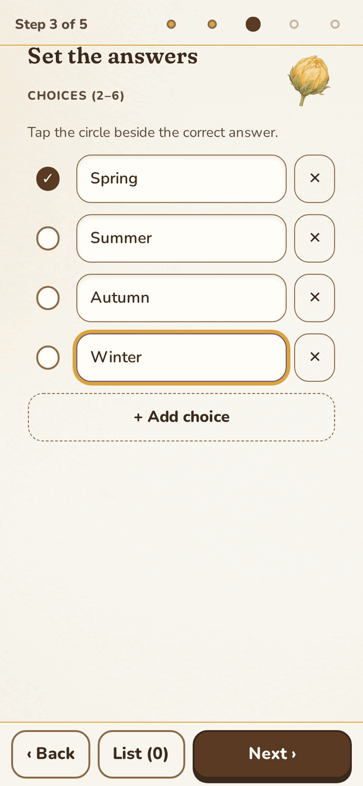 |

**Refreshing screenshots.** After a visual change, run `npm run screenshots`. It plays a demo game on a throwaway local server. It needs Playwright and ImageMagick, which are not project dependencies. The setup is in the header of `scripts/capture-screenshots.js`.

## Run a game night in 5 steps

1. Get the game running (see [Deploying](#deploying); a laptop on the venue Wi-Fi is enough).
2. Open the site on the computer connected to the big screen, choose **Host a game**, and enter the host PIN.
3. Pick a question pack and how many questions. Reverent packs use muted visuals, no confetti, and spelling off by default.
4. Show the room code (4 letters and numbers, such as `K7QM`) and the QR code. Everyone scans it or taps **Join a game**, and picks a name.
5. Press **Start game** within 5 minutes (a countdown shows in the lobby, and **End room** closes it early) of the last player joining, or the room closes and you create a new one. After each question you see the answer, an explanation and the source; at the end there is a podium.

If the host page is reloaded it resumes the same game, and players who lose signal rejoin automatically.

## Question formats

- **Single choice** and **multiple choice** (select all that apply)
- **True / false**
- **Sequence puzzle**: "put the events of this Holy Day in order" by tapping items in order (tap a numbered item to remove it, or Reset to clear all). A favourite.
- **Spelling**: read the written clue and type the word. Players see a hint (first letter, blanks, and the letter count). Close spellings score: neighbouring-key typos and swapped or doubled letters cost little, case and apostrophes never matter, and correct accents earn a 10% bonus. There is no audio anywhere in the game.

Faster correct answers score more, unless the host turns on **gentle scoring** on the create screen (on by default for reverent packs), where only correctness counts. The host can tap **Extend +15s** during a question, up to 3 times. Phones show a short "How to play" screen before the first question, and the host lobby has a how-to card.

## Names and scores

Nobody types a name, which keeps things safe and friendly. Each player gets a generated name such as "Hopeful Lily", plus an emoji or a number badge, and can shuffle for another. The host screen shows a live top-5 sidebar, and each player's phone shows their own rank ("#3 of 12").

## Local development

```
git clone <your-fork-url>
cd game_show
npm ci
npm run dev
```

No secrets are needed in development (sample packs are visible there; in production set `SHOW_SAMPLE_PACKS=1` to try them): the server prints a random admin PIN once at startup and serves on http://127.0.0.1:3719. Run the tests with `npm test`.

## Deploying

Laptop at the venue, a VPS with Apache, nginx or Caddy, Docker, or a hosting platform: see **[DEPLOY.md](DEPLOY.md)** for copy-paste instructions for each.

## Adding questions

Questions live in `questions/<pack-id>/` as `pack.json` plus `questions.jsonl`. Open `/kit` on a running server for a form that builds valid lines for you (nothing is sent anywhere; its **Download template** button gives you a starter file), paste them into the file, run `npm run validate-questions`, and restart the server. See `questions/_template` for one example of every type, [docs/QUESTION-FORMAT.md](docs/QUESTION-FORMAT.md) for every field and limit, and [docs/question.schema.json](docs/question.schema.json) for editors that validate JSON.

**Content accuracy.** The project ships only clearly fake template questions. Use authoritative Bahá'í sources (the Writings, and official publications), cite them in each question's `source` field, and carefully verify any AI-generated content before using it with your community.

## Themes and design

Each pack picks a theme (for example `naw-ruz` or `ridvan`). The visual system is documented in [DESIGN.md](DESIGN.md); `/styleguide` shows it live.

## Security

No uploads, strict input validation, a tight Content Security Policy, rate limits, and a production configuration that refuses to start without real secrets. See [SECURITY.md](SECURITY.md), including how to report a problem.

## Contributing

Fork, create a branch, make your change, run `npm test`, and open a pull request. Enable the secret-scanning pre-commit hook once per clone:

```
git config core.hooksPath .githooks
```

`CLAUDE.md` describes the architecture and the rules to follow.

## License

MIT, see `LICENSE`.
